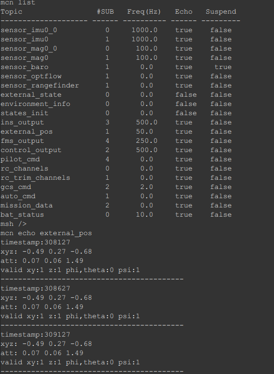
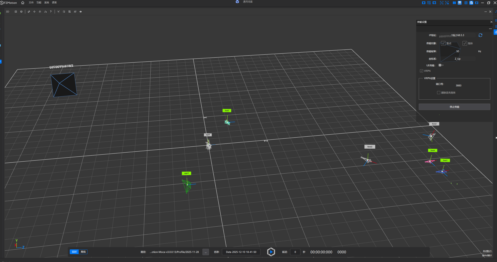

## 动捕定位

本章主要讲解如何使用动捕系统（Motion Capture System，MOCAP）设备进行定位。本章使用的深圳凌云光公司的动捕定位模块，其他公司的动捕设备可以类似配置。

使用动捕定位首先需要将飞控导航的相关参数设置如下。其中EXTPOS_PSI_MODE为1表示使用EXTPOS_PSI参数作为动捕系统X轴方向的航向角偏移，这里EXTPOS_PSI为pi/2，表示当飞机机头朝向动捕的X轴时，飞机的航向角（由动捕系统给出）为90度。这一步是为了将飞机的坐标系与动捕系统的坐标系进行对齐。

```
[*]             EXTPOS_POS_GAIN: 8.000000 [2.000000]
[*]             EXTPOS_VEL_GAIN: 6.000000 [1.500000]
[*]          EXTPOS_BIAS_A_GAIN: 0.200000 [0.100000]
[*]            EXTPOS_POS_DELAY: 30 [20]
[*]             EXTPOS_PSI_MODE: 1 [3]
[*]                  EXTPOS_PSI: 1.570800 [0.000000]
[*]              EXTPOS_USE_POS: 1 [0]
[*]              EXTPOS_USE_ALT: 1 [0]
                 EXTPOS_USE_ATT: 0
[*]              EXTPOS_USE_PSI: 1 [0]
```

动捕的数据先传输给机载计算机，再由机载计算机经由Mavlink消息（MAVLINK_MSG_ID_VISION_POSITION_ESTIMATE）发送给飞控，飞控默认会使用外部定位的位置、高度和航向角信息进行融合。

飞控接收到外部定位数据后，会将其转换为external_pos的uMCN消息进行发布，导航系统会订阅这条消息，并进行融合。若动捕数据无效，需停止发送，这样飞控将停止使用外部定位数据进行融合。

使用`mcn echo external_pos`可以查看收到的动捕数据信息（请确保飞控这边收到的动捕数据为FRD坐标系，其中F方向跟动捕的X轴方向对应）。

 <p align="left">
 	
 </p>

动捕系统的设置如下所示，方向为Z_UP，这样确保经过mavros转换（如果用到的话）后的飞控收到的外部定位数据的坐标系为FRD坐标系，其中F方向跟动捕的X轴方向对应。

 <p align="left">
 	
 </p>
