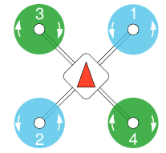
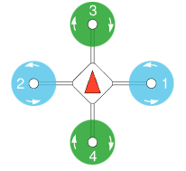
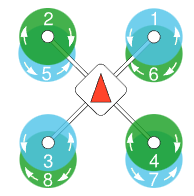
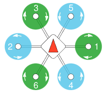
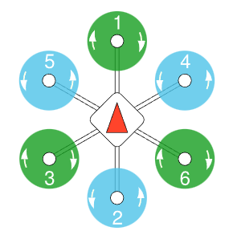
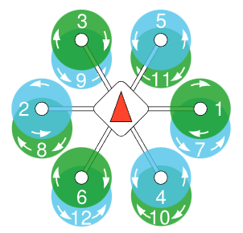
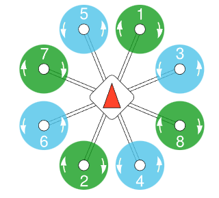
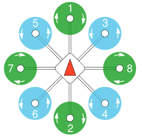
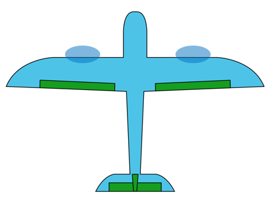

## 载具/机架

FMT 能够控制多种载具和机架，而且可以轻松添加算法来控制更多类型的载具。

本文档旨在列出这些选项。但请注意，部分机架类型的开发仍在进行中，并未完全完成，具体请咨询FMT官方团队或者提交issue。我们非常欢迎支持更多载具类型的贡献。

#### 多旋翼
| Airframe                        | Build Command                             | Description                          |
| ------------------------------- | ----------------------------------------- | ------------------------------------ |
| Quadcopter x, Airframe=1        | scons --vehicle=Multicopter --airframe=1  |      |
| Quadcopter +, Airframe=2        | scons --vehicle=Multicopter --airframe=2  |      |
| Coxial Quadcopter x, Airframe=3 | scons  --vehicle=Multicopter --airframe=3 |  |
| Hexacopter x, Airframe=4        | scons --vehicle=Multicopter --airframe=4  |      |
| Hexacopter +, Airframe=5        | scons --vehicle=Multicopter --airframe=5  |      |
| Coxial Hexacopter x, Airframe=6 | scons --vehicle=Multicopter --airframe=6  |  |
| Octocopter x, Airframe=7        | scons --vehicle=Multicopter --airframe=7  |      |
| Octocopter +, Airframe=8        | scons --vehicle=Multicopter --airframe=8  |      |

#### 固定翼
| Airframe                     | Build Command                        | Description                       |
| ---------------------------- | ------------------------------------ | --------------------------------- |
| Standard Fixwing, Airframe=1 | scons --vehicle=Fixwing --airframe=1 |  |

#### VTOL

| Airframe               | Build Command                     | Description   |
| ---------------------- | --------------------------------- | ------------- |
| 复合翼VTOL, Airframe=1 | scons --vehicle=VTOL --airframe=1 | 4+1复合翼构型 |

#### 无人车

| Airframe           | Build Command                    | Description |
| ------------------ | -------------------------------- | ----------- |
| 无人车, Airframe=1 | scons --vehicle=Car --airframe=1 |             |

#### 无人船

| Airframe           | Build Command                     | Description      |
| ------------------ | --------------------------------- | ---------------- |
| 无人船, Airframe=1 | scons --vehicle=Boat --airframe=1 | 推进器+舵机构型  |
| 无人船, Airframe=2 | scons --vehicle=Boat --airframe=2 | 双推进器差速构型 |


## Show Vehicle/Airframe Type

当系统启动并运行时，载具和机架信息会在系统信息的`Vehicle`和`Airframe`中显示，您可以使用 `boot_log` 命令查看系统信息，如下所示：

```shell

   _____                               __
  / __(_)_____ _  ___ ___ _  ___ ___  / /_
 / _// / __/  ' \/ _ `/  ' \/ -_) _ \/ __/
/_/ /_/_/ /_/_/_/\_,_/_/_/_/\__/_//_/\__/
Firmware.....................FMT FW v0.5.5
Kernel....................RT-Thread v4.0.3
RAM.................................448 KB
Target...........................Amov-ICF5
Vehicle........................Multicopter
Airframe.................................1
INS Model..................Base INS v0.3.2
FMS Model..................Base FMS v0.4.0
Control Model.......Base Controller v0.2.4
Task Initialize:
  mavobc................................OK
  mavgcs................................OK
  logger................................OK
  status................................OK
  vehicle...............................OK
```
